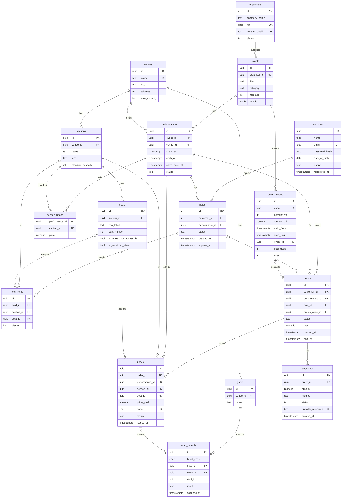

# Ticketing

A ticketing platform for concerts, theatre, comedy and sport in venues across Portugal. Customers hold seats, pay, cancel and receive tickets, and gate staff scan them at the door. The hard part is the on-sale moment, when thousands of customers try to buy the same seats at the same time, so PostgreSQL enforces that a seat is never sold twice, a standing section never goes over capacity and a promo code is never used more than its maximum.

## Run it from a clean clone

You need Docker with Docker Compose, [uv](https://docs.astral.sh/uv/) and a Bash shell (Git Bash on Windows).

```bash
git clone https://github.com/dinobuefixe/Ticketing.git
cd Ticketing
cp .env.example .env
docker compose up -d
./scripts/setup.sh
./scripts/seed.sh
```

- Replace every `change-me` in `.env` with your own secrets before running `setup.sh`. The roles and passwords are read from that file.
- `setup.sh` creates the PostgreSQL roles, runs the migrations, creates the MongoDB user and collections and checks Redis. It can be run again without errors.
- `seed.sh` loads the demo data and takes about 5 minutes: 30 venues, 4,000 performances, 100,000 customers, about 480,000 orders and 1.1 million tickets, plus the MongoDB reports and the Redis counters.
- The scripts need Unix line endings. On Windows, run them from Git Bash.
- If uv picks a Python newer than 3.13, run `export UV_PYTHON=3.12` first.

Check that everything is up:

```bash
curl -s localhost:8000/health/services
```

The API is at `http://localhost:8000` and the interactive OpenAPI page is at `http://localhost:8000/docs`.

## Run the concurrency test

The API must be running. The runner prints the mode, the successes, the refusals, the 5xx errors and a result, and exits with 0 or 1.

```bash
uv run python scripts/run_concurrency.py --base-url http://localhost:8000
```

| Scenario | What it does | Expected result |
|---|---|---|
| `same-seat` | 50 clients hold the same seat at the same moment, the winner pays | 1 success, 49 refused, 1 valid ticket |
| `last-places` | 100 clients buy the last 10 places of a standing section | 10 successes, 90 refused, 10 tickets in the database |
| `promo` | 20 clients use a promo code with 5 uses | 5 successes, 15 refused, 5 uses in the database |

To run only some of them: `--only last-places promo`.

## Stack and why

| Part | Choice | Why |
|---|---|---|
| API | Python, FastAPI, uvicorn | Small and fast to write, and it generates the OpenAPI page for free |
| Source of truth | PostgreSQL 16 | Money and seats need transactions, row locks, unique indexes, triggers and CHECK constraints, so the database refuses a wrong sale even if the app has a bug |
| Migrations | Alembic | Versioned, repeatable schema changes in `postgres/migrations/` |
| Reports and logs | MongoDB 7 | Report collections are derived documents shaped for aggregation pipelines, and the hold-attempt log expires with a TTL index after 90 days |
| Real-time data | Redis 7 | The seat map, the hold expiry, the hold-attempt limit and the trending list need fast reads and keys that expire |
| Run | Docker Compose, uv | One command per service and a pinned Python environment |

PostgreSQL is written first and always wins. Redis and MongoDB hold copies that can be rebuilt from it (`redis/rebuild.py`, `mongodb/export_reports.py`). See [docs/architecture.md](docs/architecture.md).

The project does not use Django or Prisma. The PostgreSQL files are the Alembic migrations in `postgres/migrations/`, the seed in `postgres/seed/` and a schema snapshot in `scripts/schema.sql`.

## PostgreSQL ER diagram



## API

The interactive OpenAPI page is at `http://localhost:8000/docs`.

**Who is acting.** There is no login. A request says who is acting with the `X-User-Id` header, which holds the customer's UUID. The server checks that the hold or order belongs to that user and answers 404 otherwise. Check-in carries the staff member in the body (`staff_id`), and cancelling a performance is a back-office action with no user header.

| Flow | Endpoint | Who |
|---|---|---|
| Health | `GET /health/services` | Anyone |
| Events | `GET /events/search?limit=20` | Anyone |
| F1 Seat map | `GET /performances/{performance_id}/seat-map` | `X-User-Id` |
| F2 Hold | `POST /performances/{performance_id}/holds` | `X-User-Id` |
| F3 Checkout | `POST /checkout` | `X-User-Id` |
| F4 Cancel an order | `POST /orders/{order_id}/cancel` | `X-User-Id` |
| F5 Check-in | `POST /checkin` | Gate staff (`staff_id` in the body) |
| F6 Cancel a performance | `POST /performances/{performance_id}/cancel` | Back office, no header |
| F7 Reports | `GET /reports` and `GET /reports/{performance-sales, revenue-by-organiser, top-events-by-city, occupancy, promo-effectiveness, failed-attempts-by-hour}` | Back office |

## Authors

| Part | Name | GitHub | Email |
|---|---|---|---|
| Setup, 1. Seats and holds (F1, F2) | Dinis | [dinobuefixe](https://github.com/dinobuefixe) | 235762133+dinobuefixe@users.noreply.github.com |
| 2. Purchase and tickets (F3, F4, F5, F6) | Sabrina | [sabsushi](https://github.com/sabsushi) | sabrina.etic@gmail.com |
| 3. Data and reports (F7) | Cris | [CrisAxe](https://github.com/crisaxe)  | 78100242+CrisAxe@users.noreply.github.com |


## Documentation

| Document | What it covers |
|---|---|
| [docs/architecture.md](docs/architecture.md) | Which engine is the source of truth for each piece of data and what happens if the second write fails |
| [docs/concurrency.md](docs/concurrency.md) | The concurrency rules, the tests and how the database enforces them |
| [docs/postgres.md](docs/postgres.md) | The PostgreSQL design, indexes and `EXPLAIN` evidence |
| [docs/mongodb.md](docs/mongodb.md) | The MongoDB collections and the report pipelines |
| [docs/redis.md](docs/redis.md) | The Redis keys, expiry and rebuild |
| [docs/runbook.md](docs/runbook.md) | How to operate, rebuild and troubleshoot |
| [docs/ai-usage.md](docs/ai-usage.md) | Where AI was used and what was checked by hand |